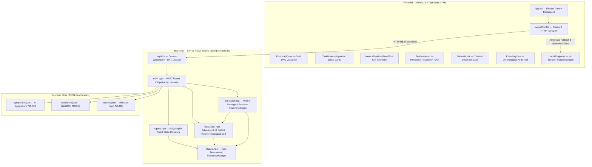

# 🛡️ Project Aegis

> **Autonomous Multi-Agent Planning, Coordination & Selective Recovery System**  
> *Delhi Technological University (DTU) — Department of Computer Science & Engineering*  
> *Object-Oriented Programming (OOP) Course Project — Team Nexus*

[](https://en.cppreference.com/w/cpp/17)
[](https://react.dev/)
[](https://www.typescriptlang.org/)
[](https://learn.microsoft.com/en-us/windows/win32/winsock/windows-sockets-start-page-2)
[](#-object-oriented-design--the-4-pillars)
[](#-academic-acknowledgment--team-nexus)

---

## 📌 Executive Summary

Modern multi-agent systems coordinating enterprise campus operations—such as university symposiums, hackathons, and exhibitions—frequently suffer from fragile execution. When individual domain agents (e.g., Venue Booking, Technical Logistics, Speaker Management) propose schedules, their tasks share critical resource bottlenecks and strict sequential dependencies. 

If an unexpected disruption occurs midway through execution (such as an audio-visual equipment delay of 4 hours), conventional scheduling systems either:
1. **Crash or enter deadlock**, failing to propagate the delay across interdependent tasks, or
2. **Recompute the entire plan from scratch**, discarding completed work, needlessly re-booking confirmed vendors, and racking up astronomical disruption costs.

**Project Aegis** solves this with a **Deterministic C++17 Multi-Agent Coordination Engine** paired with a **Reactive React + TypeScript Visual Dashboard**. Aegis models event coordination as a Directed Acyclic Graph (DAG) with capacity-constrained interval scheduling, and introduces a **Selective Downstream Recovery Engine** using Breadth-First Search (BFS) to surgically isolate and reschedule *only* affected downstream tasks while preserving unaffected parallel tracks and already-completed work.

---

## 🏗️ System Architecture



---

## ✨ Key Features

- **Autonomous Multi-Agent Planning**: Specialized autonomous agents (`VenueAgent`, `LogisticsAgent`, `SpeakerAgent`) generate isolated proposals with durations, costs, priorities, dependencies, and required resources.
- **Strict DAG Dependency Scheduling ($O(V + E)$)**: Employs Kahn’s algorithm to detect cycles and calculate a deterministic topological execution order.
- **Encapsulated Interval Resource Manager**: Prevents conflicts on physical university assets (auditoriums, labs, electrical grids, AV setups) using interval intersection validation.
- **Surgical Selective Recovery (Star Feature)**: When an active task is disrupted or delayed:
  - Traverses the DAG using Breadth-First Search (BFS) to identify strictly reachable downstream dependents.
  - Automatically freezes all unaffected tasks and finished tasks in place.
  - Reschedules only the affected subgraph, reallocating resource intervals while applying a realistic penalty model (10% reschedule disruption overhead).
- **Zero-Dependency Native C++ HTTP Server**: Custom HTTP/1.1 server built entirely on Windows native `Winsock2` (`ws2_32`) without bulky third-party libraries (no Boost, no Crow).
- **Interactive SRE Mission Control UI**:
  - Live SVG DAG visualizer with topological layering and animated Bézier curves.
  - Interactive Task Inspector to fine-tune duration, priority, and budget on the fly.
  - Failure Simulation Modal to trigger arbitrary delays on scheduled tasks.
  - 4-metric KPI dashboard: **Makespan**, **Budget Tracker (₹ INR)**, **Disruption Rate**, and **Preserved vs. Replanned Ratio**.
  - Dual-mode operation with automatic fallback to an in-browser TypeScript engine if the backend service is offline.

---

## 🎯 Object-Oriented Design & The 4 Pillars

Project Aegis was designed from the ground up to embody core Object-Oriented Programming (OOP) principles in modern C++17:

| OOP Pillar | Architectural Implementation | Concrete Code Evidence |
|:---|:---|:---|
| **Encapsulation** | `ResourceManager` strictly hides resource intervals | In [`Models.hpp`](backend/include/Models.hpp), the internal `std::unordered_map<std::string, std::vector<TimeInterval>> intervals` is private. State mutations occur exclusively via public methods `reserve()`, `release()`, and `isAvailable()`, maintaining the invariant that no single resource can have overlapping intervals. |
| **Abstraction** | Abstract `Agent` contract hides domain intricacies | In [`Agents.hpp`](backend/include/Agents.hpp), the abstract base class `Agent` declares pure virtual methods: `getAgentName()`, `getAgentType()`, and `generateProposals()`. The REST orchestrator in [`main.cpp`](backend/src/main.cpp) interacts solely with the abstract `Agent*` interface without knowing domain-specific details. |
| **Inheritance** | Class specialization for domain agents & scheduling | `VenueAgent`, `LogisticsAgent`, and `SpeakerAgent` inherit from `Agent`. Similarly, `PrioritySchedulingStrategy` derives from the abstract interface `ISchedulingStrategy` in [`Scheduler.hpp`](backend/include/Scheduler.hpp). |
| **Polymorphism** | Dynamic dispatch at runtime via vtables | In [`main.cpp`](backend/src/main.cpp), agent proposals are collected polymorphically: `for (const auto& agent : agents) { auto proposal = agent->generateProposals(); }`. Runtime dispatch resolves the concrete agent's implementation dynamically. |

---

## 🔬 Algorithmic Foundation

### 1. Cycle Detection & Topological Sort (Kahn's Algorithm)
- **Time Complexity:** $\mathcal{O}(V + E)$ where $V$ is number of tasks and $E$ is dependencies.
- **Process:**
  1. Computes in-degree (dependency count) for each task node.
  2. Queues nodes with an in-degree of 0.
  3. Dequeues nodes into topological sequence, decrementing neighbor in-degrees.
  4. If sorted count $\neq V$, graph contains an illegal cyclic dependency and throws an error.

### 2. Priority Interval Scheduling
- **Time Complexity:** $\mathcal{O}(V \cdot R \cdot I)$ where $R$ is resources per task and $I$ is interval count.
- **Process:** Iterates over topologically sorted tasks. For each task, finds the earliest available continuous time window $[t, t + \text{duration}]$ satisfying:
  $$\forall \text{ dependency } d: t \ge \text{endTime}(d)$$
  $$\forall \text{ resource } r: \text{isAvailable}(r, t, t + \text{duration}) == \text{true}$$

### 3. Selective Downstream Recovery (BFS Subgraph Isolation)
- **Time Complexity:** $\mathcal{O}(V + E)$
- **Algorithm:**
  ```text
  Algorithm SelectiveRecovery(failedTaskId, delayHours):
    1. downstreamSet ← BFS_Traverse(TaskGraph, failedTaskId)
    2. For each task T in TaskGraph:
         If T ∉ downstreamSet and T is SCHEDULED or COMPLETED:
             Mark T as PRESERVED (keep existing start/end times and resource reservations)
         Else:
             Release T's reserved resource intervals
             Mark T as PENDING_REPLAN
    3. Update failedTask.duration += delayHours
    4. Topologically sort downstreamSet
    5. Re-schedule each task in downstreamSet on the updated timeline
    6. Compute disruption cost penalty (10% reschedule fee on replanned tasks)
  ```

---

## 📁 Repository Structure

```text
aegis/
├── backend/
│   ├── include/
│   │   ├── httplib.h         # Zero-dependency HTTP/1.1 server on Windows Winsock2
│   │   ├── Models.hpp          # Task, TimeInterval, ResourceManager, JSON serialization
│   │   ├── Agents.hpp          # Abstract Agent base class + 3 concrete derived agents
│   │   ├── TaskGraph.hpp       # Adjacency list DAG with Kahn's topological sort
│   │   └── Scheduler.hpp       # ISchedulingStrategy & SelectiveRecoveryEngine
│   └── src/
│       └── main.cpp            # REST API router, server entry point, orchestration glue
├── frontend/
│   ├── src/
│   │   ├── api/
│   │   │   ├── aegisClient.ts  # Typed HTTP client communicating with backend
│   │   │   └── mockEngine.ts   # In-browser fallback engine for standalone demos
│   │   ├── components/
│   │   │   ├── PlanGraphView.tsx # Interactive SVG DAG renderer with Bézier curves
│   │   │   ├── TaskNode.tsx      # Individual status cards with priority/agent pills
│   │   │   ├── MetricsPanel.tsx  # KPI summary panel (Makespan, Budget, Disruption)
│   │   │   ├── TaskInspector.tsx # Slide-out live parameter editor
│   │   │   ├── FailureModal.tsx  # Chaos/failure injection modal
│   │   │   └── EventLogView.tsx  # Real-time event and audit log viewer
│   │   ├── lib/
│   │   │   └── format.ts       # Indian Rupee (₹ INR) currency and date formatters
│   │   ├── types/
│   │   │   └── aegis.ts        # TypeScript domain models and API schemas
│   │   ├── App.tsx             # Root component and scenario orchestration
│   │   └── index.css           # Tailwind CSS styling and theme definitions
│   ├── package.json
│   └── vite.config.ts
├── scenarios/
│   ├── symposium.json          # 6 tasks: National AI Symposium (₹60,000)
│   ├── hackathon.json          # 8 tasks: HackDTU 24-Hour Hackathon (₹80,000)
│   └── robotics.json           # 7 tasks: DTU Robotics Innovation Expo (₹75,000)
├── test_recovery.cpp           # Standalone unit test suite (30+ assertions)
├── CMakeLists.txt              # CMake build configuration
└── README.md                   # Project documentation
```

---

## 📡 REST API Reference

The backend exposes an HTTP/1.1 REST interface on `http://localhost:8080` (with full CORS preflight support):

| Endpoint | Method | Description |
|:---|:---:|:---|
| `/api/health` | `GET` | Health probe; returns status `ok`, version, and active scenarios. |
| `/api/scenarios` | `GET` | Lists all available event benchmarks (`symposium`, `hackathon`, `robotics`). |
| `/api/scenario?id={name}` | `GET` | Fetches details and initial task blueprints for a given scenario. |
| `/api/agents` | `GET` | Returns registered agents and their specialization areas. |
| `/api/plan` | `POST` | Executes multi-agent coordination, graph construction, and full priority scheduling. |
| `/api/recover` | `POST` | Simulates task failure/delay and performs selective BFS replanning on downstream tasks. |

### Sample Payload: `/api/recover`
```json
// POST /api/recover
{
  "scenarioId": "symposium",
  "failedTaskId": "task_keynote",
  "delayHours": 4
}
```
**Response:**
```json
{
  "status": "success",
  "recovered": true,
  "metrics": {
    "makespanHours": 18,
    "totalCost": 58500,
    "disruptionScore": 0.25,
    "tasksPreserved": 3,
    "tasksReplanned": 3
  },
  "tasks": [ ... ]
}
```

---

## 🚀 Getting Started

### Prerequisites
- **C++17 Compiler**: GCC (`g++` 9+), Clang 10+, or MSVC 2019+
- **Build System**: CMake 3.16+ (or direct compiler invocation)
- **Node.js**: v18.0.0 or higher with `npm`

---

### 1. Build and Run the Backend

#### Option A: Using CMake
```powershell
# Navigate to project root
cd c:\Projects\aegis

# Configure and build
cmake -B build -S .
cmake --build build --config Release

# Start the server (runs on http://localhost:8080)
.\build\Release\aegis_server.exe
```

#### Option B: Direct Compilation with `g++` (MinGW on Windows)
```powershell
# Compile directly linking Winsock2
g++ -std=c++17 -Wall -O2 -Ibackend/include backend/src/main.cpp -lws2_32 -o aegis_server.exe

# Start the server
.\aegis_server.exe
```

---

### 2. Start the Frontend Visualizer

```powershell
# Navigate to frontend directory
cd frontend

# Install dependencies
npm install

# Start development server
npm run dev
```

Open your browser at **`http://localhost:5173`**.  
The dashboard will automatically connect to `http://localhost:8080`. If the backend is not running, the dashboard smoothly falls back to the client-side mock engine with an indicator badge.

---

### 3. Run the Backend Unit Test Suite

A standalone test suite validates Kahn's DAG sorting, resource isolation invariants, and selective recovery:

```powershell
# Compile the test runner
g++ -std=c++17 -Wall -Wextra -Ibackend/include test_recovery.cpp -o test_recovery.exe

# Run test cases
.\test_recovery.exe
```

**Expected output:**
```text
=== Aegis Recovery Engine Test Suite ===
[TEST 1] TaskGraph & Kahn's Topological Sort
  ok    order.size() == 4
  ok    order[0] == "A"
[TEST 2] PrioritySchedulingStrategy Invariants
  ok    plan.status == PlanStatus::COMPLETED
  ok    plan.tasks[0].status == TaskStatus::SCHEDULED
[TEST 3] SelectiveRecoveryEngine (Downstream Isolation)
  ok    result.tasksReplanned == 2
  ok    result.tasksPreserved == 2
All tests passed successfully!
```

---

## 👥 Academic Acknowledgment & Team Nexus

This project was built for the **Object-Oriented Programming (OOP) Course** at **Delhi Technological University (DTU)** by **Team Nexus**:

### 🔵 Keshav Jain (Lead Architecture & Integration)
- **Core Domain Modeling**: Designed [`Models.hpp`](backend/include/Models.hpp) (`Task`, `TimeInterval`, and encapsulated `ResourceManager`).
- **Abstract Agent Framework**: Designed abstract `Agent` class and implemented concrete agents (`VenueAgent`, `LogisticsAgent`, `SpeakerAgent`) in [`Agents.hpp`](backend/include/Agents.hpp).
- **Native Network Engine**: Created zero-dependency HTTP server on native Windows Winsock2 in [`httplib.h`](backend/include/httplib.h).
- **REST Dispatcher & Pipeline Glue**: Built orchestrator in [`main.cpp`](backend/src/main.cpp), integrating multi-agent coordination with the graph scheduling engine.
- **Interactive UI Components**: Implemented `TaskInspector.tsx`, scenario switcher, currency normalization (₹ INR), and end-to-end integration.

### 🟢 Team Partner (dominatingspirit — Algorithms & Visualization)
- **DAG Data Structure**: Designed [`TaskGraph.hpp`](backend/include/TaskGraph.hpp) implementing Kahn’s topological sort and cycle validation.
- **Scheduling Strategies**: Implemented `ISchedulingStrategy` interface and `PrioritySchedulingStrategy` in [`Scheduler.hpp`](backend/include/Scheduler.hpp).
- **Selective Recovery Engine**: Authored BFS downstream subgraph isolation algorithm and penalty calculation model in [`Scheduler.hpp`](backend/include/Scheduler.hpp).
- **Visual DAG Canvas**: Built SVG graph visualizer (`PlanGraphView.tsx`), status cards (`TaskNode.tsx`), and dynamic edge routing.
- **Telemetry & Validation**: Created `MetricsPanel.tsx`, `FailureModal.tsx`, `EventLogView.tsx`, and standalone verification suite (`test_recovery.cpp`).

---

## 📜 License

Developed as part of the academic curriculum for the Department of Computer Science & Engineering, Delhi Technological University (DTU). Free for educational and research use.
